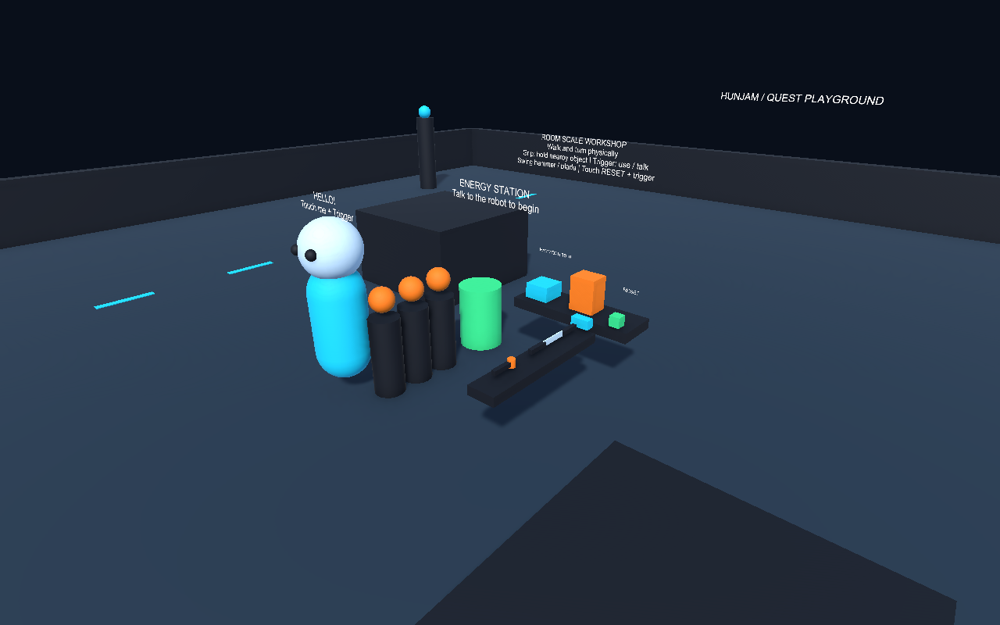

# HunJam 2026 — Quest Playground

Unity **6000.3.28f1**, URP, Meta Quest standalone / OpenXR / Touch kontrollerek.

## Indítás
1. Unity Hubban a `My project` mappát add hozzá; ugyanazt az Editor-verziót használd.
2. Várd meg a csomagok importját és a fordítást.
3. Nyisd meg: `Assets/_Game/Scenes/DemoWorld.unity`, majd Play.
4. Unity Play módban Quest Linkkel tesztelj. Headset nélkül csak álló előnézet van; a mechanikákat a PlayMode tesztek ellenőrzik.
5. Beszélj a robottal, gyűjtsd össze a három energiagömböt, és engedd őket a központi célállomásba. Beszélj újra a robottal az új körhöz.

Questen: kizárólag fizikai séta és fordulás. Grip: közeli tárgy megfogása; trigger: használat vagy közeli beszélgetés. Kalapáccsal üthetsz, pengével vághatod a blokkot, a lámpát triggerrel kapcsolhatod. Üres kézzel érintsd meg a RESET gombot és nyomj triggert az eszközpróba újraindításához. Nincs joystickmozgás vagy teleport.

A demó szerkeszthető scene-t, prefabokat és materialokat tartalmaz. A `HunJam/Generate Demo World` menü csak tudatos újragenerálásra való: felülírja a demó generált tartalmát. A `HunJam/Configure Quest` a Quest buildbeállításokat alkalmazza.

Munkakezdés: [AGENTS.md](AGENTS.md). Dokumentáció: [Docs/README.md](Docs/README.md). Build és eszközteszt: [Docs/QUEST_SETUP.md](Docs/QUEST_SETUP.md).

Új interakciók: közvetlen kézváltás, kétkezes rúd, dinamikusan téphető szerződés és szúrási próba a kezdőpont mögötti asztalon. A másik grip csatlakozik, az első elengedése átadja a tárgyat. A lapot két oldalt fogva húzd szét. Külön jelenetek: `Assets/_Game/Scenes/VRInteractionTest.unity` és `FlightYoke.unity`; a zöld scene-gombokat üres kézzel, triggerrel használhatod. [Indítás, reset és teljes tesztlista](Docs/VR_INTERACTION_TESTS.md).
